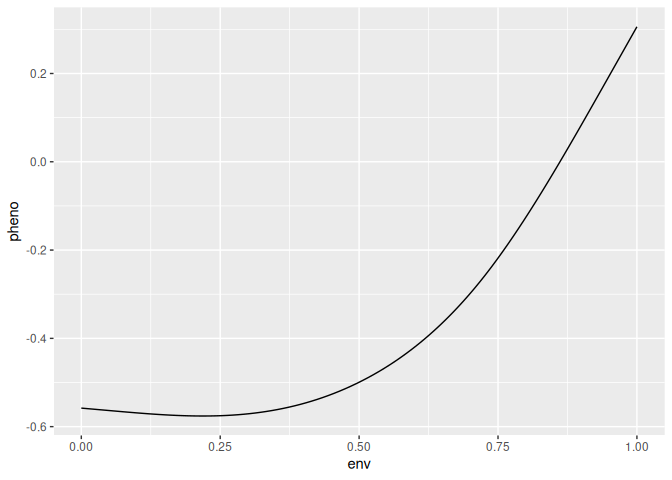
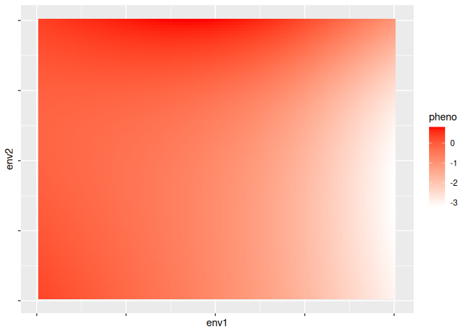

<!-- README.md is generated from README.Rmd. Please edit that file -->

# rcspline

<!-- badges: start -->

[](https://github.com/marioasmira/rcspline/actions/workflows/R-CMD-check.yaml)
[](https://app.codecov.io/gh/marioasmira/rcspline)
<!-- badges: end -->

A simple R package to calculate restricted cubic splines.

## Installation

You can install the development version of rcspline from
[GitHub](https://github.com/) with:

``` r
# install.packages("pak")
pak::pak("marioasmira/rcspline")
```

Alternatively, with `devtools`:

``` r
# install.packages("devtools")
devtools::install_github("marioasmira/rcspline")
```

## Example

This package relies on the creation of a matrix object which can be
repeatedly used with specifically sized vectors to generate non-linear
reaction norms. For example, to generate a reaction norm with 5 knots
(`k = 5`) and a precision of 100, we first generate a matrix with:

``` r
library(rcspline)
library(ggplot2)

p <- 100
knots = 5

m1 <- make_matrix(
  precision = p,
  k = knots,
  dimensions = 1
)
```

The matrix can then be used to generate non-linear reaction norms using
vectors of length `k` with function `spline_1d()`:

``` r
set.seed(14232)
vec <- rnorm(knots)

reac_norm <- spline_1d(vector = vec, matrix = m1)

plot_reac_norm <- data.frame(
  env = m1[, 2],
  pheno = reac_norm
)
ggplot(
  data = plot_reac_norm,
  aes(x = env, y = pheno)
  ) +
  geom_line()
```



A reaction norm with two dimensions can be created with a similar
process. In this case, the required vector is of size `k^2`:

``` r
m2 <- make_matrix(
  precision = p,
  k = knots,
  dimensions = 2
)

set.seed(12342)
vec2 <- rnorm(knots^2)

reac_norm2 <- spline_2d(vector = vec2, matrix = m2)

library(tidyverse)

plot_reac_norm2 <-
  reac_norm2 %>%
  as_tibble() %>%
  rownames_to_column("Var1") %>%
  pivot_longer(-Var1, names_to = "Var2", values_to = "value") %>%
  mutate(
    Var1 = as.numeric(Var1),
    Var2 = as.numeric(gsub("V", "", Var2))
  )

ggplot(plot_reac_norm2, aes(Var1, Var2)) +
  geom_tile(aes(fill = value)) +
  scale_fill_gradient(low = "white", high = "red") +
  xlab("Env 1") +
  ylab("Env 2") +
  theme(axis.text.x = element_blank(), axis.text.y = element_blank())
```


