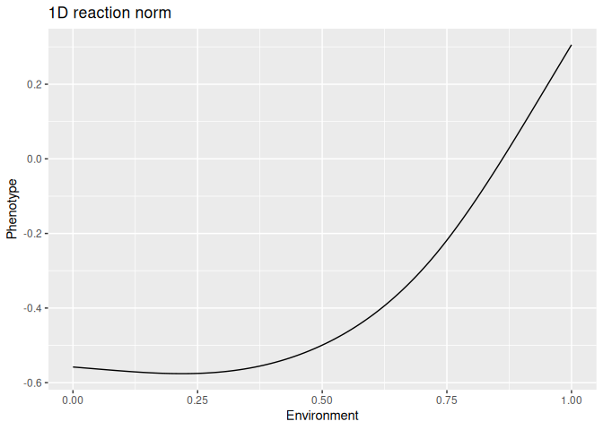
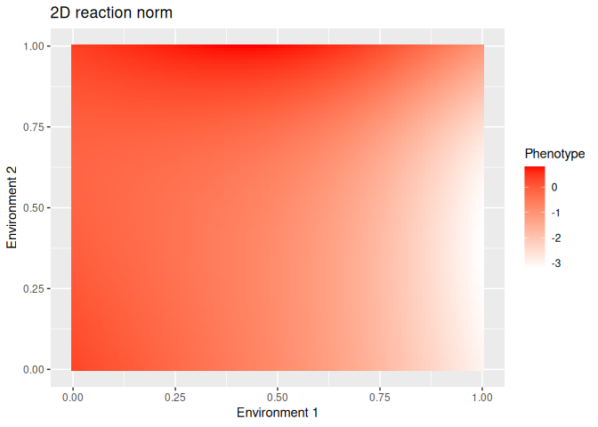
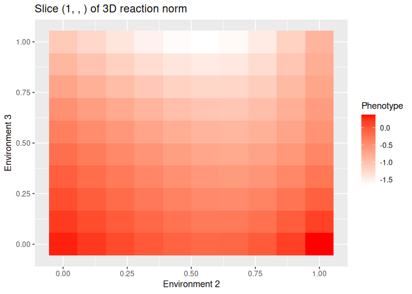

<!-- README.md is generated from README.Rmd. Please edit that file -->

# rcspline

<!-- badges: start -->

[](https://github.com/marioasmira/rcspline/actions/workflows/R-CMD-check.yaml)
[](https://app.codecov.io/gh/marioasmira/rcspline)

<!-- badges: end -->

A simple R package to calculate restricted cubic splines.

## Installation

You can install the development version of rcspline from
[GitHub](https://github.com/) with:

``` r
# install.packages("pak")
pak::pak("marioasmira/rcspline")
```

Alternatively, with `devtools`:

``` r
# install.packages("devtools")
devtools::install_github("marioasmira/rcspline")
```

## Usage

This package relies on the creation of a matrix object which can be
repeatedly used with specifically sized vectors to generate non-linear
reaction norms. The three main variables necessary are:

- `precision`: the granularity with which to represent the environment;
- `k`: the number of knots used during the calculations. More knots can
  lead to more complex shapes but also more computation time. A `k = 5`
  seems to be good enough for the situations I’ve found so far;
- `dimensions`: the number of environments to study. This package is
  prepared to deal mostly with positive values of the environment, but
  transformations can be used to change the interpretation of outcomes.

The functions in this package use these variables to first create the
pre-calculation matrix (*e.g.*,
`m <- make_matrix(precision = 100, k = 5, dimensions = 1)`) and then use
this matrix with a provided (or evolved) vector to calculate the
reaction norm (*e.g.*,
`nspline(vector = vec, matrix = m, dimensions = 1, precision = 100)`).

## Examples

### One dimensional reaction norm

For example, to generate a reaction norm with 5 knots (`k = 5`) and a
precision of 100 (`p = 100`), we first generate a matrix with:

``` r
library(rcspline)

p <- 100
k <- 5

m1 <- make_matrix(
  precision = p,
  k = k,
  dimensions = 1
)
```

The matrix can then be used to generate non-linear reaction norms using
vectors of length `k` with function `nspline()`:

``` r
set.seed(14232)
vec <- rnorm(k)

reac_norm <- nspline(vector = vec, matrix = m1, dimensions = 1, precision = p)
```

The `plot_1d()` function allows for simple plotting of the reaction norm
which can be modified like other `ggplot2` plots:

``` r
library(ggplot2)
plot_reac_norm <- plot_1d(m1, reac_norm)

plot_reac_norm +
  ggtitle("1D reaction norm") +
  ylab("Phenotype") +
  xlab("Environment")
```



### Two dimensional reaction norm

A reaction norm with two dimensions can be created with a similar
process. In this case, the required vector is of size `k^2`:

``` r
m2 <- make_matrix(
  precision = p,
  k = k,
  dimensions = 2
)

set.seed(12342)
vec2 <- rnorm(k^2)

reac_norm2 <- nspline(vector = vec2, matrix = m2, dimensions = 2, precision = p)
```

Which, like in the one dimensional example, can be plotted with
`plot_2d()`:

``` r
plot_reac_norm2 <- plot_2d(m2, reac_norm2)

plot_reac_norm2 +
  ggtitle("2D reaction norm") +
  ylab("Environment 2") +
  xlab("Environment 1") +
  labs(fill = "Phenotype")
```



### Three dimensional reaction norm

This package can help with three dimensional (and above) reaction norms,
although the compute times and memory requirements increase quickly. An
example of a three dimensional reaction norm:

``` r
p3 <- 10 # notice the lower precision
m3 <- make_matrix(
  precision = p3,
  k = k,
  dimensions = 3
)

set.seed(12342)
vec3 <- rnorm(k^3)

reac_norm3 <- nspline(vector = vec3, matrix = m3, dimensions = 3, precision = p3)
```

Plotting a three dimensional object is complicated, but we can instead
plot slices of `reac_norm3`. We generate a two dimensional matrix (with
the same parameters) to help `plot_2d()`:

``` r
helper_m2 <- make_matrix(
  precision = p3,
  k = k,
  dimensions = 2
)

plot_reac_norm3.1 <- plot_2d(helper_m2, reac_norm3[1, , ])

plot_reac_norm3.1 +
  ggtitle("Slice (1, , ) of 3D reaction norm") +
  ylab("Environment 3") +
  xlab("Environment 2") +
  labs(fill = "Phenotype")
```


